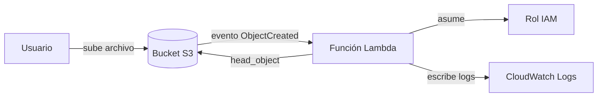
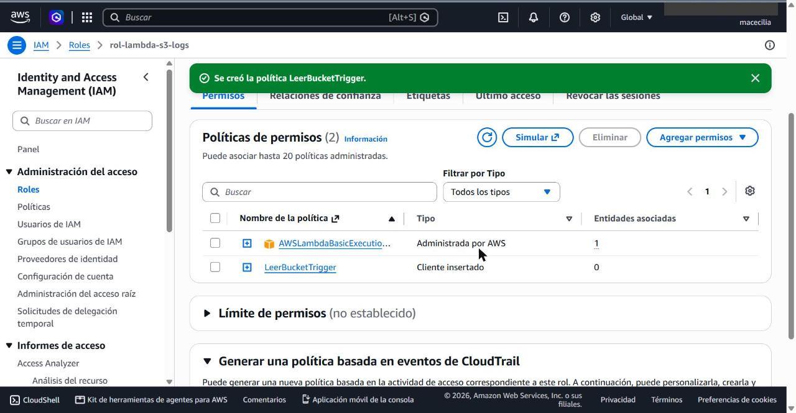
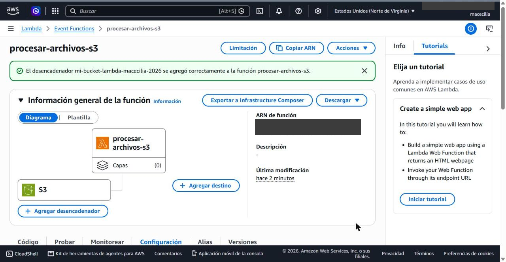
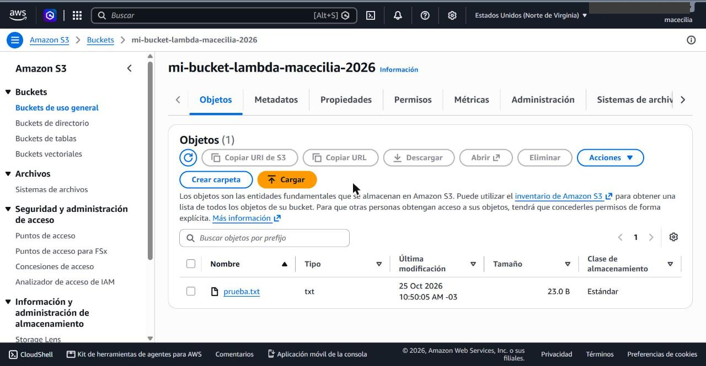
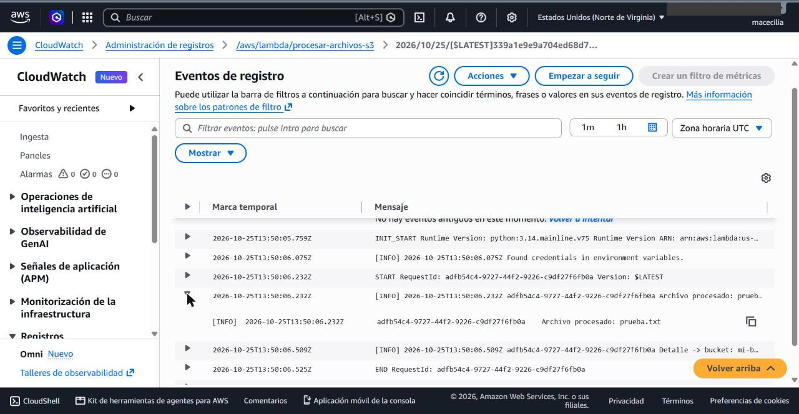

# Mi primera Lambda en AWS: procesamiento de archivos subidos a S3

Arquitectura **event-driven** (orientada a eventos): cuando se sube un archivo a un bucket de Amazon S3, S3 dispara automáticamente una función AWS Lambda, que registra en Amazon CloudWatch Logs el mensaje `Archivo procesado: <nombre-del-archivo>`.

Escenario elegido: **A (S3)**. Runtime: **Python 3.14**.

## Contenido del repositorio

| Archivo | Para qué sirve |
| --- | --- |
| `lambda_function.py` | Código de la función |
| `iam_policy.json` | Política inline del rol: permite `s3:GetObject` solo en el bucket del trigger |
| `trust_policy.json` | Política de confianza: solo el servicio Lambda puede asumir el rol |
| `eventos/evento_prueba_s3.json` | Evento de ejemplo para probar la función desde la consola |
| `capturas/` | Evidencia de la ejecución |

## Qué hace la función, paso a paso

1. S3 detecta que se creó un objeto en el bucket y envía un evento a Lambda con la lista `Records`.
2. La función recorre cada registro y obtiene el nombre del bucket y del archivo. Decodifica el nombre, porque S3 lo envía codificado (por ejemplo, los espacios llegan como `+`).
3. Escribe en los logs `Archivo procesado: <nombre-del-archivo>`.
4. Consulta los metadatos del archivo (`head_object`), que requiere el permiso `s3:GetObject`, y registra el tamaño y el tipo de contenido.
5. Devuelve la lista de archivos procesados. Si falta un permiso, el error queda registrado en CloudWatch.

## Permisos (IAM) y por qué

El rol `rol-lambda-s3-logs` combina dos políticas:

- **`AWSLambdaBasicExecutionRole`** (administrada por AWS): permite crear el grupo de logs y escribir en CloudWatch (`logs:CreateLogGroup`, `logs:CreateLogStream`, `logs:PutLogEvents`). Sin ella, la función se ejecuta pero no deja evidencia.
- **`iam_policy.json`** (inline): permite solo `s3:GetObject` y solo sobre los objetos del bucket del trigger. Aplica el principio de mínimo privilegio: la función no puede borrar, escribir ni ver otros buckets.

> El permiso para que **S3 invoque a Lambda** no va en este rol: la consola lo agrega automáticamente a la función (política basada en recursos) al crear el trigger.

## Despliegue

1. **Crear el bucket** en S3 `mi-bucket-lambda-macecilia-2026` en la región `us-east-1`. El bucket y la función deben estar en la misma región.
2. **Crear el rol:** IAM → Roles → Create role → *AWS service* → *Lambda*. Adjuntar `AWSLambdaBasicExecutionRole`. Luego, en el rol: *Add permissions* → *Create inline policy* → pestaña JSON → pegar `iam_policy.json`.
3. **Crear la función:** Lambda → Create function → *Author from scratch* → nombre `procesar-archivos-s3`, runtime *Python 3.14* → *Permissions* → *Use an existing role* → `rol-lambda-s3-logs`.
4. **Pegar el código** de `lambda_function.py` en el editor y pulsar **Deploy**. El handler debe quedar como `lambda_function.lambda_handler`.
5. **Agregar el trigger:** *+ Add trigger* → S3 → elegir el bucket → tipo de evento *All object create events* → aceptar el aviso sobre invocación recursiva.
6. **Probar:** subir un archivo cualquiera al bucket (por ejemplo `prueba.txt`).
7. **Verificar:** pestaña *Monitor* → *View CloudWatch logs* → abrir el stream más reciente.

**Sobre el timeout:** la función solo lee metadatos, una operación de milisegundos, así que el límite por defecto de 3 segundos es suficiente.

## Evidencia de ejecución

### 1. Rol IAM con sus dos políticas

### 2. Función desplegada con el trigger de S3

### 3. Archivo subido al bucket

### 4. Log en CloudWatch con "Archivo procesado"

## Limpieza

Para no generar costos, al terminar se borra el trigger, la función, los archivos y el bucket, el grupo de logs `/aws/lambda/procesar-archivos-s3` y el rol.
