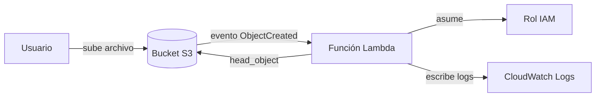
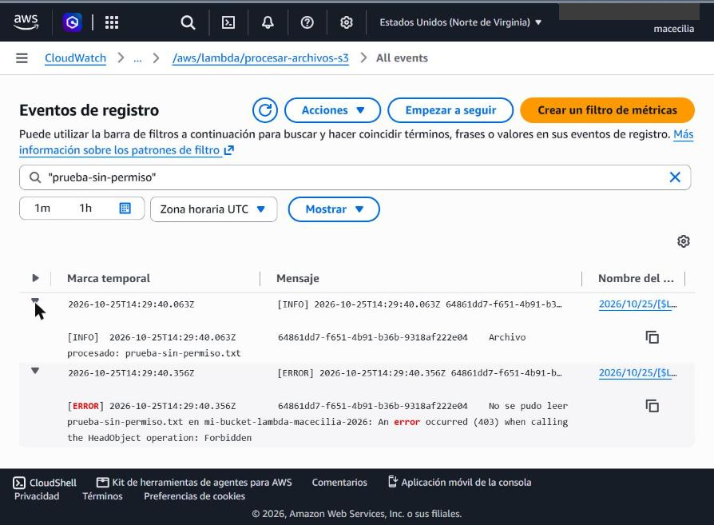

# Mi primera Lambda en AWS: procesamiento de archivos subidos a S3

| | |
| --- | --- |
| **Repositorio** | [`MaCecilia92/mi-primera-lambda-aws`](https://github.com/MaCecilia92/mi-primera-lambda-aws) |
| **Mantenido por** | [@MaCecilia92](https://github.com/MaCecilia92) |
| **Contexto** | Práctica del módulo de cómputo serverless, curso AWS Cloud Practitioner |
| **Clonar** | `git clone https://github.com/MaCecilia92/mi-primera-lambda-aws.git` |

Arquitectura **event-driven** (orientada a eventos): cuando se sube un archivo a un bucket de Amazon S3, S3 dispara automáticamente una función AWS Lambda, que registra en Amazon CloudWatch Logs el mensaje `Archivo procesado: <nombre-del-archivo>`.

Escenario elegido: **A (S3)**. Runtime: **Python 3.14**.



## Contenido del repositorio

| Archivo | Para qué sirve |
| --- | --- |
| `lambda_function.py` | Código de la función |
| `iam_policy.json` | Política inline del rol: permite `s3:GetObject` solo en el bucket del trigger |
| `trust_policy.json` | Política de confianza: solo el servicio Lambda puede asumir el rol |
| `eventos/evento_prueba_s3.json` | Evento de ejemplo para probar la función, en la consola o en local |
| `probar_local.py` | Ejecuta la función en tu computadora con el evento simulado |
| `capturas/` | Evidencia de la ejecución |

## Qué hace la función, paso a paso

1. S3 detecta que se creó un objeto en el bucket y envía un evento a Lambda con la lista `Records`.
2. La función recorre cada registro y obtiene el nombre del bucket y del archivo. Decodifica el nombre, porque S3 lo envía codificado (por ejemplo, los espacios llegan como `+`).
3. Escribe en los logs `Archivo procesado: <nombre-del-archivo>`.
4. Consulta los metadatos del archivo (`head_object`), que requiere el permiso `s3:GetObject`, y registra el tamaño y el tipo de contenido.
5. Devuelve la lista de archivos procesados. Si falta un permiso, el error queda registrado en CloudWatch.

## Permisos (IAM) y por qué

El rol `rol-lambda-s3-logs` combina dos políticas:

- **`AWSLambdaBasicExecutionRole`** (administrada por AWS): permite crear el grupo de logs y escribir en CloudWatch (`logs:CreateLogGroup`, `logs:CreateLogStream`, `logs:PutLogEvents`). Sin ella, la función se ejecuta pero no deja evidencia.
- **`iam_policy.json`** (inline): permite solo `s3:GetObject` y solo sobre los objetos del bucket del trigger. Aplica el principio de mínimo privilegio: la función no puede borrar, escribir ni ver otros buckets.

> El permiso para que **S3 invoque a Lambda** no va en este rol: la consola lo agrega automáticamente a la función (política basada en recursos) al crear el trigger.

## Despliegue

1. **Crear el bucket** en S3 `mi-bucket-lambda-macecilia-2026` en la región `us-east-1`. El bucket y la función deben estar en la misma región.
2. **Crear el rol:** IAM → Roles → Create role → *AWS service* → *Lambda*. Adjuntar `AWSLambdaBasicExecutionRole`. Luego, en el rol: *Add permissions* → *Create inline policy* → pestaña JSON → pegar `iam_policy.json`.
3. **Crear la función:** Lambda → Create function → *Author from scratch* → nombre `procesar-archivos-s3`, runtime *Python 3.14* → *Permissions* → *Use an existing role* → `rol-lambda-s3-logs`.
4. **Cargar el código:** pegar `lambda_function.py` en el editor y pulsar **Deploy**, o subirlo comprimido en *Actualizar → Actualizar desde un archivo .zip*. La segunda opción evita que el editor altere la sangría de Python. El handler debe quedar como `lambda_function.lambda_handler`.
5. **Agregar el trigger:** *+ Add trigger* → S3 → elegir el bucket → tipo de evento *All object create events* → aceptar el aviso sobre invocación recursiva.
6. **Probar:** subir un archivo cualquiera al bucket (por ejemplo `prueba.txt`).
7. **Verificar:** pestaña *Monitor* → *View CloudWatch logs* → abrir el stream más reciente.

**Sobre el timeout:** la función solo lee metadatos, una operación de milisegundos, así que el límite por defecto de 3 segundos es suficiente.

## Prueba local, antes de desplegar

`probar_local.py` ejecuta `lambda_handler` en tu computadora con `eventos/evento_prueba_s3.json` como evento. Así se prueba un cambio en segundos, sin subir nada a AWS.

```bash
pip install boto3
python probar_local.py           # simulado: no usa AWS ni credenciales
python probar_local.py --error   # simulado: S3 responde 403 (falta s3:GetObject)
python probar_local.py --real    # llama a S3 de verdad con tus credenciales
```

En el modo simulado, el script reemplaza la respuesta de S3 con `botocore.Stubber`, así que no necesita conexión ni cuenta de AWS. Salida real del modo simulado:

```text
Evento simulado: archivo 'prueba.txt' en el bucket 'mi-bucket-lambda-macecilia-2026'

[INFO] Archivo procesado: prueba.txt
[INFO] Detalle -> bucket: mi-bucket-lambda-macecilia-2026 | tamaño: 18 bytes | tipo: text/plain

Respuesta: {'statusCode': 200, 'body': '{"archivos_procesados": ["prueba.txt"]}'}
```

## Evidencia de ejecución

### 1. Rol IAM con sus dos políticas


### 2. Función desplegada con el trigger de S3


### 3. Archivo subido al bucket


### 4. Log en CloudWatch con "Archivo procesado"


### 5. Escenario de error: sin el permiso `s3:GetObject`
Para validar el manejo de `ClientError`, se quitó temporalmente la política inline `LeerBucketTrigger` del rol y se subió el archivo `prueba-sin-permiso.txt`. La función registró primero `Archivo procesado`, luego el error `403 Forbidden` al llamar a `HeadObject`, y relanzó la excepción, por lo que la invocación quedó marcada como fallida. Después se restauró la política.



**Qué demuestra:**

- Sin el permiso, Lambda sigue ejecutándose, pero el rol no puede leer el archivo. El error queda registrado con su causa, en lugar de fallar en silencio.
- Como el trigger de S3 invoca la función de forma **asíncrona**, Lambda reintenta automáticamente hasta 2 veces. En CloudWatch se vieron 3 intentos con el mismo `RequestId`: 14:29:40, 14:30:42 y 14:32:36 (UTC). Por eso es importante relanzar la excepción con `raise`: si la función la ocultara, Lambda creería que todo salió bien y no reintentaría.
- Al restaurar la política y subir `prueba-restaurada.txt`, la función volvió a registrar `Archivo procesado` y el detalle del archivo, sin errores.

## Lambda vs EC2

| | AWS Lambda (serverless) | Amazon EC2 (IaaS) |
| --- | --- | --- |
| **Qué administrás** | Solo el código y sus permisos | El sistema operativo, sus parches, el runtime y la aplicación |
| **Cuándo corre** | Solo cuando llega un evento | Todo el tiempo que la instancia esté encendida |
| **Escalado** | Automático, una ejecución por evento | Manual, o con Auto Scaling configurado por vos |
| **Duración máxima** | 15 minutos por ejecución | Sin límite |
| **Cobro** | Por solicitud y por tiempo de ejecución | Por segundo u hora encendida, aunque esté ociosa |
| **Ideal para** | Tareas cortas disparadas por eventos, como esta | Procesos largos, servidores siempre activos o software que exige un SO concreto |

**Para esta práctica conviene Lambda:** procesar un archivo tarda menos de un segundo y solo ocurre cuando alguien sube algo. Con EC2 habría que pagar y mantener un servidor encendido las 24 horas para esperar esos eventos.

## Modelo de facturación y capa gratuita

Lambda cobra por dos conceptos:

1. **Solicitudes:** USD 0,20 por cada millón de invocaciones.
2. **Duración:** tiempo de ejecución multiplicado por la memoria asignada, medido en GB-segundo. En x86 y `us-east-1` cuesta USD 0,0000166667 por GB-segundo. La memoria va de 128 MB a 10.240 MB.

La **capa gratuita de Lambda** incluye cada mes **1 millón de solicitudes y 400.000 GB-segundo**.

**Cálculo de esta función:** con 128 MB (0,125 GB) y unos 293 ms de ejecución, cada invocación consume 0,125 × 0,293 ≈ 0,037 GB-segundo. La capa gratuita alcanza para alrededor de 10 millones de ejecuciones de duración al mes, así que en la práctica el límite lo pone el millón de solicitudes gratuitas. Esta práctica cuesta USD 0.

> **Cuentas nuevas:** desde el 15 de julio de 2025, AWS reemplazó la capa gratuita de 12 meses por créditos: USD 100 al registrarse, más hasta USD 100 por completar actividades, en un plan gratuito de hasta 6 meses. Las cuentas creadas antes de esa fecha conservan las condiciones anteriores, por ejemplo 750 horas mensuales de EC2 `t2.micro` durante el primer año. En cambio, EC2 no tiene un uso gratuito permanente como el de Lambda.

Precios de referencia: [AWS Lambda pricing](https://aws.amazon.com/lambda/pricing/). Conviene verificarlos antes de usar la función en producción.

## Limpieza

Para no generar costos, al terminar se borra el trigger, la función, los archivos y el bucket, el grupo de logs `/aws/lambda/procesar-archivos-s3` y el rol.

> **Estado:** el 25 de octubre de 2026, una vez tomadas las capturas, se eliminaron la función, el bucket con sus archivos, el grupo de logs y el rol. Este repositorio y las capturas quedan como evidencia de la práctica.
